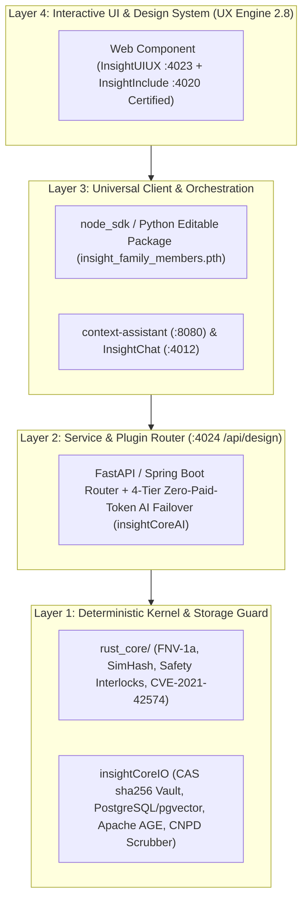

# 🏛️ Architecture & Deep-Dive Explanation (`InsightDesign`)

> **Project**: `InsightDesign` | **Default Port**: `:4024` | **API Prefix**: `/api/design`
> **Stack**: 4-Layer Hybrid Polyglot (Rust Core + Python FastAPI + Node.js SDK + TypeScript Web Component)

---

## 1. Why `InsightDesign` Exists & How It Fits in the Ecosystem

**`InsightDesign`** — *All-Domain Spatial, 3D Three.js, Blender bpy, Parametric CAD (.STL/.STEP), Interactive Draw, Playable 3D Games & Open-Source Canva Brand/Slidev Deck Engine* — is designed around a **Modular Hybrid Polyglot Architecture**. Rather than trapping domain logic inside a single monolithic codebase, `InsightDesign` exposes its capabilities across four clean layers so every project in the ecosystem can consume it with zero duplication:

---

## 2. Integration with the Tri-Pillar Design & Inclusivity Suite
- **[`InsightInclude™ (:4020)`](https://github.com/brunoAmado/InsightInclude)**: Audits `InsightDesign` for EU AI Act Art. 10 demographic fairness (`DIR >= 0.80`), `INPI PPP #4` Romance gender neutralization, `Leitura Fácil`, and Portugal `DL n.º 82/2022` (WCAG 2.2 AA/AAA) assistive-tech compliance.
- **[`InsightUIUX™ (:4023)`](https://github.com/brunoAmado/InsightUIUX)**: Audits `InsightDesign`'s 2D interfaces for *UX Engine 2.8* Anti-AI-Slop rules, concentric border radii ($R_{\text{outer}} = R_{\text{inner}} + \text{padding}$), 7-decision `1.25` typography, **Open-Source Penpot W3C Design Tokens**, and **Sovereign Mobbin Reference Patterns**.
- **[`InsightDesign™ (:4024)`](https://github.com/brunoAmado/InsightDesign)**: Provides 3D Three.js digital-twin scenes, Blender `bpy` scripts, watertight `.STL` parametric CAD enclosures, interactive vector drawing canvases, playable WASD 3D simulations, and **Open-Source Canva SVG / Slidev presentation decks**.

---

## 3. Sovereign AST Knowledge Graph (`InsightCode™ :4013`) & Three-Amigos BDD
- **AST Cartography**: `InsightDesign` is continuously indexed by **`InsightCode™ (:4013)`** (which replaced legacy `Graphify`) and stored in `context-assistant`'s **Apache AGE (`GraphService`)** call graph.
- **Three-Amigos BDD Suite**: Living Epics (`docs/epics/*.epic.md`), User Stories (`docs/stories/*.story.md`), and executable Gherkin scenarios (`features/*.feature`) are synchronized from **ChronicleRAG (`:8765`)** via `BusinessAnalystAgent`.
